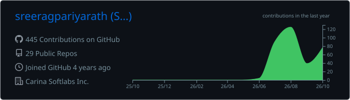
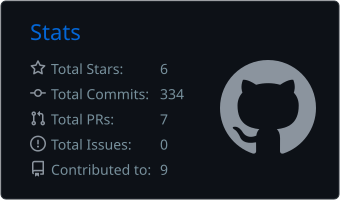
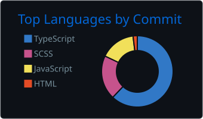
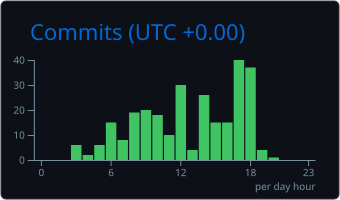
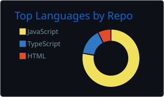

# Sreerag P

### Full Stack Engineer · TypeScript · React & Next.js · Node.js APIs

*I ship production web apps, backend APIs and developer tools, from schema design to deployment.*

 

---

## ⚡ Snapshot

| | |
|---|---|
| 🧑‍💻 **Focus** | Full stack web apps, backend APIs, developer tooling |
| 🏗️ **Shipped** | A children's learning app live on **Google Play** and the **App Store** |
| 📦 **Published** | [`@erris/core`](https://www.npmjs.com/package/@erris/core) on npm, with trusted publishing and CodeQL |
| 🧭 **Experience** | About 1 year full-time, plus freelance MERN work since 2023 |
| 📍 **Based in** | Kerala, India · open to full stack roles in Kochi or remote |

---

## 🔭 Now

- 🧠 **Norix**: an offline-first repository intelligence CLI that maps unfamiliar codebases
- 🏛️ Backend architecture, system design and performance
- 🤖 Practical AI-assisted workflows: Claude Code and Copilot in daily development

---

## 🚢 Projects

<table>
<tr>
<td width="50%" valign="top">

### 🧠 Norix
**Offline-first repo intelligence CLI**

Analyzes an unfamiliar repository, detects its stack, maps its architecture and produces onboarding insights.

`Node.js` `CLI` `Static analysis`

</td>
<td width="50%" valign="top">

### 🌐 Personal Portfolio
**[sreerag.pages.dev](https://sreerag.pages.dev)**

A TypeScript site with Next.js 16 and React 19, Drizzle ORM for data, Playwright end-to-end tests, and deployment on Cloudflare.

`Next.js` `React 19` `TypeScript` `Drizzle` `Playwright` `Cloudflare`

</td>
</tr>
<tr>
<td width="50%" valign="top">

### 📚 LearnWithHupe Academy
**Children's learning platform · Google Play & App Store**

- Subscription billing across Google Play and Apple server APIs
- Curriculum management, progress tracking and offline-first sync
- Role-based admin panel and content pipeline

`Node.js` `Express` `MongoDB` `Redis` `React` `AWS` `Nginx`

</td>
<td width="50%" valign="top">

### 🛡️ Erris
**[@erris/core on npm](https://www.npmjs.com/package/@erris/core)**

Framework-agnostic error contracts for JavaScript and TypeScript, with RFC 9457 Problem Details responses and adapters for Zod and Prisma.

`TypeScript` `npm` `CI` `CodeQL` `Trusted publishing`

</td>
</tr>
<tr>
<td width="50%" valign="top">

### 🎮 Warox
**Gaming platform · public website and CMS**

- Public site in Next.js and TypeScript
- RBAC admin backend and CMS
- Multilingual content pipeline for 11 languages, including right-to-left

`Next.js` `TypeScript` `Node.js` `MongoDB` `Redis` `Stripe`

</td>
<td width="50%" valign="top">

### 🍔 QuickBite
**Food ordering and restaurant platform**

Customer ordering, a restaurant dashboard and an admin portal, built as NestJS microservices with a Next.js frontend.

`NestJS` `Next.js` `Microservices` `REST APIs`

</td>
</tr>
</table>

---

## 🧰 Skills

**Languages**
-F7DF1E?style=flat-square&logo=javascript&logoColor=black)

**Frontend**

**Backend & APIs**

**Auth & Security**

**Databases**

**Cloud & DevOps**

**Testing**

**AI-assisted development**

**Tools & Open Source**

---

## 🧭 How I work

- **Start from the data.** Schemas, indexes and access rules come before the screens.
- **Ship with tests.** Unit tests for logic, end-to-end tests for flows, regression tests for production bugs.
- **Write it down.** Technical handover documents, design RFCs and clear commit history.
- **Use AI, review everything.** AI tools speed up the work, and I check their output before it ships.

---

## 📈 GitHub Stats

  

  
  

  
  

---

### 📫 Let's build something

